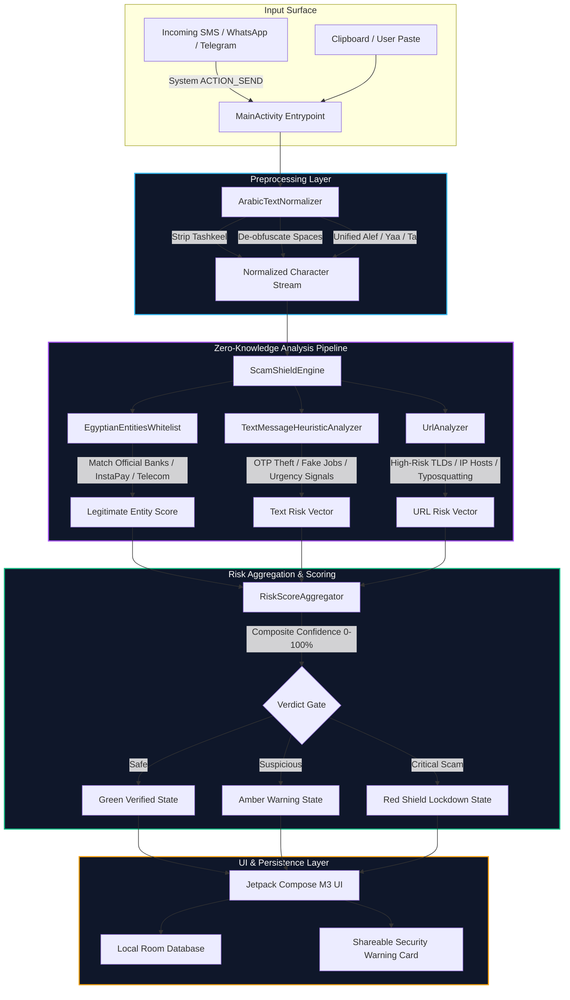

# كاشف (Kashef) — Scam Shield

<p align="center">
  
  
  
  
  <a href="https://opensource.org/licenses/MIT"></a>
</p>

<p align="center">
  <strong>On-Device Zero-Knowledge Fraud &amp; Phishing Heuristic Engine for Android</strong><br />
  تطبيق أندرويد مفتوح المصدر لحماية المستخدمين في مصر والوطن العربي من الاحتيال المالي وسرقة الحسابات، يعمل بالكامل محلياً على جهازك دون إرسال أي بيانات لخوادم خارجية (Zero Telemetry).
</p>

---

## 🏛️ System Architecture (معمارية النظام)



---

## 🔒 The Zero-Knowledge Privacy Guarantee (ضمان الأمان المحلي)

Unlike typical security applications that upload your personal messages, contact lists, and browsing links to remote cloud analytics, **Kashef operates under mathematically verifiable on-device isolation**:

1. **No Network Permission**:
   The application's `AndroidManifest.xml` explicitly omits `android.permission.INTERNET`. By operating system enforcement at the Linux kernel sandbox level, it is physically impossible for the app to transmit bytes outside your device.
2. **Ephemeral Memory Processing**:
   Incoming message strings are evaluated in volatile RAM and immediately garbage-collected after classification.
3. **Encrypted Local Persistence**:
   The local Room Database (`ScanHistoryDatabase`) enforces `allowBackup="false"` to prevent automated unencrypted cloud sync, and truncates sensitive tokens before writing to disk.

---

## 🌟 المزايا الجوهرية (Core Features)

1. **فحص محلي فوري وآمن 100% (On-Device Zero Knowledge):**
   - يعمل التطبيق بالكامل دون طلب أي صلاحيات إنترنت (`No INTERNET permission`). لا يتم إرسال أي نصوص أو روابط لخوادم خارجية، مما يضمن سرية تامة لبياناتك.
2. **محرك التطبيع اللغوي العربي الذكي (Arabic Text Normalizer):**
   - تفكيك ومقاومة حيل التحايل الإملائي (إزالة التشكيل، توحيد الألفات والياء والتاء المربوطة، وتجميع المسافات المفرقة بين الحروف مثل `ت م  إ ي ق ا ف`).
3. **كشف هجمات التمويه (Camouflage Detection):**
   - التحقق من سياق الرسائل التي تستخدم روابط رسمية للتمويه بينما تطلب رموز تأكيد سرية أو سرقة أكواد الـ OTP.
4. **فحص وتجميع مخاطر الروابط المتعددة (Multi-URL Evaluation):**
   - فحص شامل لجميع الروابط الموجودة داخل الرسالة وتحديد مستوى الخطورة العام بناءً على أشد الروابط خطورة.
5. **فحص الروابط والنطاقات (Intelligent URL Heuristics):**
   - **القائمة البيضاء الرسمية (Official Whitelist):** مطابقة النطاقات الرسمية للبنوك المصرية، شبكة إنستاباي (`instapay.eg`)، فودافون كاش، أورنج، إي آند، وي، والبريد المصري.
   - **كشف انتحال الهوية (Brand Impersonation & Typosquatting):** رصد أي محاولة لاستخدام اسم مؤسسة رسمية داخل دومين مشبوه أو نطاق فرعي مضلل.
   - **رصد النطاقات الرخيصة المشبوهة (High-Risk TLDs):** فحص النطاقات سريعة الإنشاء (`.xyz`, `.top`, `.site`, `.fun`, `.club`, `.space`).
   - **كشف اختصار الروابط وعناوين IP المباشرة وإعادة التوجيه (Open Redirects).**
6. **سجل الفحوصات المحلي الآمن (Privacy-Preserving History):**
   - حفظ سجل الفحوصات محلياً عبر Room Database مع الالتزام بمبدأ تقليل البيانات (عدم حفظ النصوص الحساسة كاملة) مع إمكانية مسح السجل بضغطة زر.
7. **التكامل المباشر مع النظام (Android System Integration):**
   - يدعم **ACTION_SEND**: مشاركة أي رسالة من واتساب أو الرسائل القصيرة لتطبيق كاشف ليفحصها مباشرة، مع دعم زر "لصق وفحص".
8. **محرك التحذير (Shareable Warning Card):**
   - توليد بطاقة تحذير أمني منسقة لمشاركتها على واتساب ومنصات التواصل لتنبيه العائلة والأصدقاء.

---

## 🏗️ الهيكلية التقنية (Tech Stack)

* **UI Layer:** Jetpack Compose + Material 3 + Kotlin Coroutines + StateFlow.
* **Architecture:** Clean Architecture + MVVM + Unidirectional Data Flow (UDF).
* **Data Layer:** Room Database (SQLite) with strict zero-cloud backup (`allowBackup=false`).
* **Compatibility:** Android 7.0 (API 24) to Android 15 (API 35).

---

## 📁 هيكل المشروع (Project Layout)

```
kashef-scam-shield/
├── app/
│   ├── src/main/
│   │   ├── AndroidManifest.xml
│   │   └── java/eg/kashef/shield/
│   │       ├── KashefApp.kt
│   │       ├── MainActivity.kt
│   │       ├── core/
│   │       │   ├── analyzer/
│   │       │   │   ├── UrlAnalyzer.kt
│   │       │   │   └── TextMessageHeuristicAnalyzer.kt
│   │       │   ├── engine/
│   │       │   │   └── ScamShieldEngine.kt
│   │       │   ├── util/
│   │       │   │   └── ArabicTextNormalizer.kt
│   │       │   └── whitelist/
│   │       │       └── EgyptianEntitiesWhitelist.kt
│   │       ├── data/local/
│   │       │   └── ScanHistoryDatabase.kt
│   │       ├── domain/model/
│   │       │   └── Models.kt
│   │       └── ui/
│   │           ├── HomeScreen.kt
│   │           └── MainViewModel.kt
│   └── build.gradle.kts
├── settings.gradle.kts
├── SECURITY.md
└── CONTRIBUTING.md
```

---

## 🚀 التشغيل والتطوير (How to Run)

1. افتح المشروع في **Android Studio** أو محرر **Antigravity**.
2. اسمح لـ Gradle بمزامنة المكتبات (Sync Project with Gradle Files).
3. شغّل التطبيق على محاكي (Emulator) أو هاتف حقيقي عبر `Run 'app'`.
4. لتشغيل الاختبارات:
   ```bash
   ./gradlew test
   ```

---

## 🛡️ License & Responsible Disclosure

- **License**: [MIT License](LICENSE)
- **Security Policy**: See [SECURITY.md](SECURITY.md) for vulnerability disclosure.
